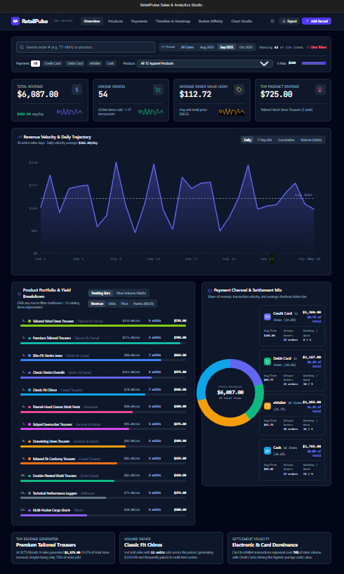

# 📊 RetailPulse — Sales & Analytics Studio

> 🚀 **Live Demo:** [Explore RetailPulse](https://interactive-sales-analytics-dashboard.netlify.app/)

**Turn raw sales records into actionable insights.**

RetailPulse is an interactive sales analytics dashboard built with React and TypeScript using Google AI Studio as part of my Coursera learning journey.

It transforms sales transaction data into visual insights through interactive charts, dynamic filters, product performance analysis and customizable visualizations.

## ✨ Features

- **Executive Overview:** Revenue, unique orders, average order value and top-performing product KPIs.
- **Dynamic Filters:** Search by order or product and filter by date, payment method and price range.
- **Revenue Analytics:** Explore daily revenue trends, moving averages, cumulative revenue and sales volume.
- **Product Performance:** Analyze product rankings, revenue contribution and sales volume.
- **Payment Analytics:** Compare revenue and transaction distribution across payment methods.
- **Temporal Heatmap:** Explore sales activity across time.
- **Basket Affinity:** Examine product combinations within orders.
- **Custom Chart Studio:** Build visualizations using different chart types, dimensions and metrics.
- **Data Explorer:** Inspect, add, edit and delete transaction records.
- **CSV Export:** Export filtered sales records.
- **Theme Support:** Switch between light and dark modes.

## 🖥️ Dashboard Preview

### Executive Overview


### Product Performance


### Payment Analytics


### Revenue Timeline & Heatmap


### Basket Affinity


### Custom Visualization Studio

## 📁 Dataset

The dashboard uses a sales dataset containing:

| Attribute | Details |
|---|---|
| Records | 116 sales line items |
| Unique orders | 98 |
| Products | 12 |
| Payment methods | 4 |
| Date range | August 15 – October 7, 2025 |

**Data fields:**
- Order Number
- Product
- Price
- Date
- Payment Method

## 🛠️ Tech Stack

| Technology | Purpose |
|---|---|
| React 19 | UI development |
| TypeScript | Type safety |
| Vite | Development and build tooling |
| Tailwind CSS | Styling |
| Lucide React | Icons |
| Motion | Animations |
| Google AI Studio | AI-assisted application development |


## 📁 Project Structure

```text
interactive-sales-analytics-dashboard/
│
├── public/
│   └── assets/
│
├── docs/
│   └── screenshots/
│
├── src/
│   ├── components/
│   │   ├── BasketAnalysisChart.tsx
│   │   ├── CustomVisualizerStudio.tsx
│   │   ├── DataTableExplorer.tsx
│   │   ├── FilterToolbar.tsx
│   │   ├── MetricCard.tsx
│   │   ├── PaymentMethodChart.tsx
│   │   ├── ProductPerformanceChart.tsx
│   │   ├── RevenueTimelineChart.tsx
│   │   ├── TemporalHeatmap.tsx
│   │   ├── TopBar.tsx
│   │   └── TransactionModal.tsx
│   │
│   ├── data/
│   ├── App.tsx
│   ├── index.css
│   └── main.tsx
│
├── .env.example
├── .gitignore
├── index.html
├── package.json
├── tsconfig.json
└── vite.config.ts
```

**Architecture:** React components handle the dashboard interface, visualizations, filtering and transaction interactions, while the data layer supports sales analytics.


## 🚀 Getting Started

### Prerequisites
- Node.js
- npm

### Installation

```bash
# Clone the repository
git clone https://github.com/RITOJAPODDAR/interactive-sales-analytics-dashboard.git

# Navigate into the project
cd interactive-sales-analytics-dashboard

# Install dependencies
npm install

# Start the development server
npm run dev
```

Open the local URL displayed in your terminal (the configured development port is 3000).

### Production Build

```bash
npm run build
```

### Preview Production Build

```bash
npm run preview
```

## 📚 Learning Context

Developed as part of my Coursera learning journey using Google AI Studio.

This project helped me explore AI-assisted application development, interactive data visualization, reusable React components and data-driven dashboard design.

## 🔗 Links

- **GitHub Repository:** https://github.com/RITOJAPODDAR/interactive-sales-analytics-dashboard
- **Google AI Studio:** https://aistudio.google.com/apps/f58761b7-2255-4034-bfd4-0ca9e839f113?showPreview=true

---

*Built with curiosity, data and a little too much love for dashboards. 💜*
